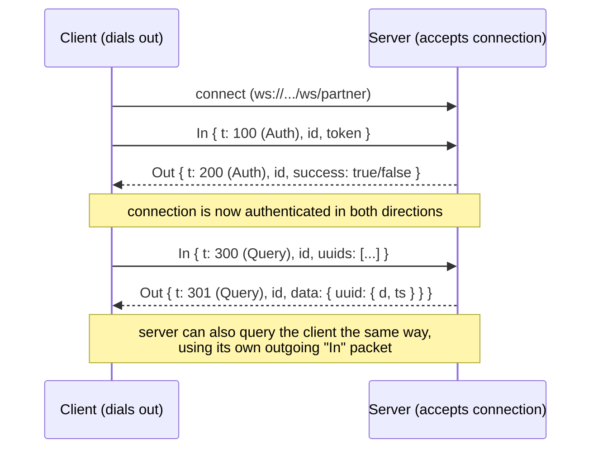

# Partner Cache Protocol

A WebSocket protocol for sharing cached [Hypixel](https://api.hypixel.net) SkyBlock profile
data between two independent backend services. When one side already has a profile cached,
the other can get it from there and save a call on its own Hypixel API key.

## Why this exists

Both services track SkyBlock player data and cache Hypixel's `/v2/skyblock/profiles`
response per player. They often request the same players, so most of that Hypixel traffic
was duplicated: two servers with two API keys, both fetching the exact same JSON.

Instead of merging infrastructure, we built a peer-to-peer layer on top of each service's
existing cache:

- Each side keeps caching exactly like it did before.
- One side connects out to the other over a WebSocket and authenticates with a shared secret.
- Either side can then ask the other "do you have this UUID cached?" and get back the cached Hypixel response.

## How it works



The full wire format is in [`PROTOCOL.md`](./PROTOCOL.md).

## Repo layout

```
server/    Server-side implementation (accepts the incoming WebSocket and handles auth and sends/answers queries)
client/    Client-side implementation (connects to the server side, authenticates and sends/answers queries)
example.kt a simple example usage
PROTOCOL.md  Wire protocol specification
```

## Design decisions

- **Cache the raw Hypixel response.** The two sides don't have to agree on a data shape,
  only on what Hypixel returned for a UUID. Each service parses the raw JSON with its own
  existing logic.

- **Fetch timestamps instead of TTLs.** Each `Entry.timestamp` is the UTC time the data was
  originally fetched from Hypixel. The receiving side applies its own staleness rules and
  doesn't have to trust the sender's cache policy.

## Authors

- [Noamm9](https://github.com/Noamm9): client implementation, protocol co-design
- [skies-starred](https://github.com/skies-starred): server implementation, protocol co-design